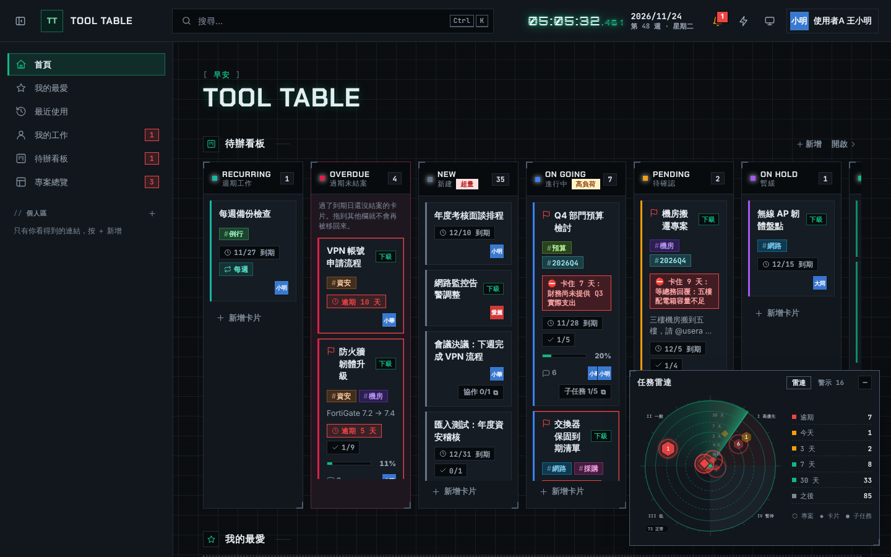
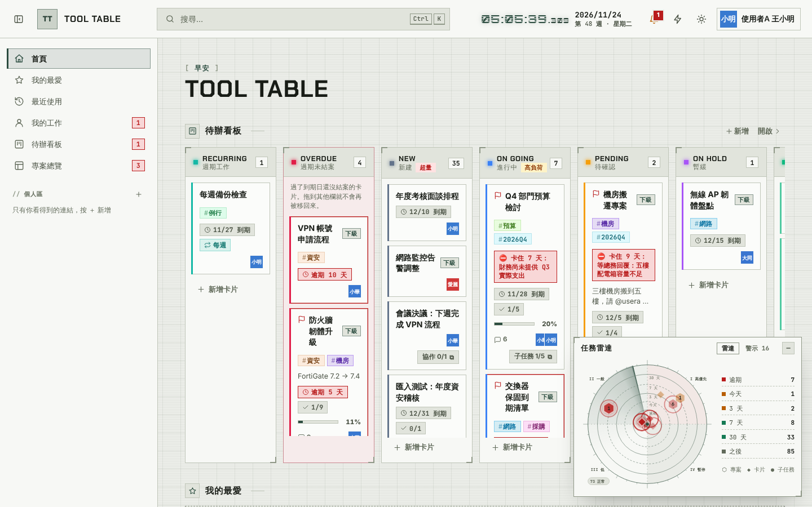
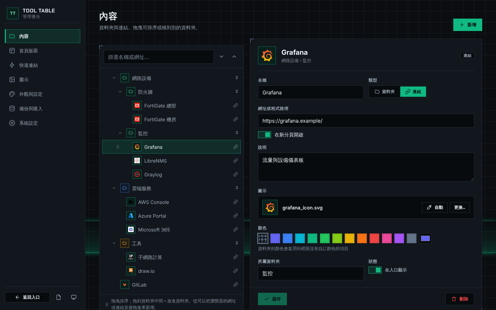

# Tool Table


可以自由組裝的連結入口網站。
資料夾、連結、首頁版面、配色、頁首元件**全部在管理後台調整**，不用改任何程式碼——
拿來做 IT 工具入口、部門系統入口、文件中心、個人書籤都可以。



| 淺色主題 | 管理後台 |
|---|---|
|  |  |

---

## 功能

### 入口網站
- **首頁由區塊組成**：公告、快速連結、我的最愛、最近使用、所有分類，或把任一個資料夾直接攤在首頁；順序、標題、卡片大小都能調
- **側邊欄可收合**：左上角按鈕或 `Ctrl + B` 收成圖示列（每人記住自己的選擇）；收合時滑鼠移上去、或拖曳網址經過時會自動浮出完整側邊欄
- **資料夾無限層級**：側邊欄樹狀導覽、麵包屑、每個資料夾都有自己的網址（可加書籤、支援上一頁）
- **搜尋面板**：`Ctrl/⌘ + K` 或 `/` 叫出，鍵盤上下選、Enter 開啟；比對名稱、說明、網址、路徑與圖示；也會搜尋待辦看板的卡片（標題、說明、留言內容、建立者與負責人），選了直接開啟卡片。只會找到你有權限看到的卡片；Shift+Enter 開完整結果頁
- **我的最愛 / 最近使用**：每位使用者各自的（存在瀏覽器），不需登入
- **拖曳網址直接新增**：把瀏覽器網址列、網頁上的連結或書籤拖進頁面，自動帶入標題並比對圖示。拖到左側或頁面上的某個資料夾（資料夾卡片、首頁的資料夾區塊、已開啟的資料夾頁面）就放進那個資料夾，其他地方則放在最上層；拖曳時會標示目標（可在設定關閉）
- **自動取得網站圖示**：新增網址時，圖示庫沒有對應圖示就自動抓網站自己的圖示（優先高解析度的 apple-touch-icon），內網自簽憑證的網站也行
- **本機程式（Windows 單機版）**：把程式的捷徑（.lnk）、網址捷徑（.url）或執行檔（.exe）拖進來，自動讀出路徑、參數與程式圖示；點卡片就直接啟動程式（也可以開文件或資料夾）
- **待辦看板**：Trello 式卡片看板，分 週期工作 / 過期未結案 / New / On going / Pending / On hold / Complete / Canceled 欄位，拖曳卡片換狀態與排序；每張卡可設開始日、到期日（可含時間）、優先順序與提醒（到期時、15 分鐘、1 小時、1 天、2 天、1 週前）。逾期、今天到期、該開始了的卡片會醒目標示，右上角 🔔 與側邊欄顯示數量，允許的話還會跳出桌面通知；可以放在首頁，也有獨立的看板頁
- **週期工作**：卡片可設為每天、每個工作日、每週（可選星期幾）、每月、每年重複，並可設「每 N 天／週／月／年」。到了截止時間（全天卡片為當天 18:00）會跳出視窗問你是否結案：按「結案並排下一次」，這張移到 Complete，同時自動複製一張到下一個截止日、放進「週期工作」欄；也可以「1 小時後再問」。直接把卡片拖到 Complete 或在編輯視窗改成 Complete 也會排下一次（只會建立一張）；錯過好幾期時，下一張直接排到今天之後
- **協作（伺服器版）**：卡片有建立者與負責人；管理員可以指派，任何人都能在說明或留言 `@` 同事（輸入時自動提示 AD 裡的人），被 @ 的人會看到這張卡片並收到通知；右上角 🔔 列出被指派、被提到與新留言
- **子任務與留言串（專案管理）**：卡片就是摘要任務（summary task）。留言可以由作者編輯（顯示「已編輯」），每則留言都能「回覆」（留言串，回覆別人的回覆會自動 @ 對方並通知整串的人）；能編輯卡片的人可以把留言「設為子任務」，每個子任務跟卡片一樣，按「編輯」可修改名稱、說明（留言內容）、附件、狀態（New／On going／Pending／On hold／Complete／Canceled）、優先順序、開始／到期日（可含時間）、提醒、負責人與預估工時；常用欄位也能直接在子任務區塊修改。子任務負責人可以修改指派以外的所有內容，提醒會出現在他的 🔔，並可「▶ 開始計時／■ 停止」或手動「記錄工時」（每筆可寫備註與日期，可展開明細）；按「■ 停止」時會立刻詢問「這段時間做了什麼？」並可修正時數與日期，明細裡每一筆也能按 ✎ 修改說明、時數與日期（自己的工時，或能編輯卡片的人）。卡片上方會彙總：完成進度（x/y，% 進度條）、已記錄／預估工時、子任務期間與逾期數；看板上的卡片顯示子任務進度，自己正在計時時顯示「計時中」。被指派子任務的人會收到通知、在 🔔 看到自己子任務的到期與逾期提醒，並且能看到這張卡片（唯讀＋留言），只能更新自己子任務的狀態與工時；改派或結案會停止原本的計時。週期工作排下一次時，子任務會一起複製（狀態歸零、日期順延）。彙總區下方列出子任務大綱（編號、狀態、負責人、到期日），點一下跳到該子任務；能編輯卡片的人可以拖曳或用 Alt+↑/↓ 調整子任務順序，「只看子任務」也依這個順序
- **摘要卡片（狀態自動計算）**：卡片一旦有子任務，就只負責彙總，狀態不能手動改、也不能拖到其他狀態欄（同一欄內排序可以）：子任務全部完成且協作人都勾了完成 → Complete；子任務全完成但還有協作人沒勾 → Pending；全部未開始 → New；其他依 On going ＞ Pending ＞ On hold 決定（已取消的子任務不算）。過期未結案與週期工作欄位會保留到完成為止；完成時週期卡片照常排下一次。要放棄整件事可以把卡片改成 Canceled，改回其他狀態時會重新計算。沒有子任務的卡片照舊手動設定狀態。人員統計不把摘要卡片本身算成一件工作，只算子任務與協作
- **卡住標記與工作量**：卡片編輯視窗可以「⛔ 標記卡住…」並寫下卡在哪裡、在等誰（負責人、協作人與上級都可以標記或解除），會自動留一則留言並通知卡片的人與主責人的上級；卡片顯示紅框與「⛔ 卡住 N 天：原因」，人員方塊上的 ⛔ 數字表示他主責的卡片有幾張卡住，結案或取消時自動解除。各欄卡片數超過門檻時，欄位標題顯示「高負荷」或「超量」；門檻在後台「設定 → 待辦看板」調整，預設每欄 ≤5 張正常、6～8 張高負荷、≥9 張超量。Excel 報告的「最新進度」也會顯示卡住原因，表頭統計卡住項數；每個子任務下面列出**工時明細**（類型「工時」：日期、時數、記錄人、說明，可在 Excel 收合），表頭顯示工時合計，匯入時略過這些列
- **自訂標籤**：卡片可以加上自己取名的標籤（例如 `#客戶A`、`#資安`、`#2026Q4`，每張最多 8 個、每個 24 字），在編輯視窗輸入後按 Enter，或點「常用」裡已經用過的標籤。標籤顯示在卡片標題下方，同一個名稱永遠同一種顏色，一眼就能辨認（管理員可以在後台「設定 → 待辦看板 → 卡片標籤顏色」為每個標籤指定顏色，沒指定的依名稱自動配色）；點卡片上的標籤，看板就只顯示有這個標籤的卡片（再點一次或按「清除」恢復）。搜尋 `#標籤` 可以找到卡片；Excel 報告多一欄「標籤」，可以在 Excel 修改後匯入；週期卡片的下一次會沿用標籤；單機版也會同步。
- **專注模式（看板）**：看板上方列出每個人，旁邊用狀態色小方塊顯示他的工作數量（主責的卡片、指派給他的子任務、協作的卡片都算）。點一個人就專注：只留下他主責的卡片，以及別人主責、他有參與的卡片（虛線框，寫明他在裡面做什麼）；沒有卡片的狀態欄收成窄條，把空間讓給卡片；再點一次或按 Esc 取消。卡片上的「子任務 x/y · 協作 n ▸」可以展開任務樹，看每個子任務的狀態、負責人、到期與工時，以及協作人。主責人＝建立者也是負責人時為建立者，否則為第一位負責人。主卡顯示完成百分比與進度條：（已完成的子任務＋已標記完成的協作人）÷（未取消的子任務＋協作人）；協作人＝共同負責或被 @、但沒有自己子任務的人，在任務樹裡勾「完成」（本人或能編輯卡片的人可以勾）
- **Excel 工作進度報告（匯出／匯入）**：給長官看的單一分頁報表。看板上按「選取／匯出」（或 Ctrl／⌘＋點卡片）勾選卡片，也能「全選目前顯示的」，再按「匯出報告」；單張卡片也能在編輯視窗按「Excel」。報表最上方是標題、製表人與時間、範圍，以及各狀態數量、整體完成率與逾期數；下面是樹狀表：主任務（1、2…）> 子任務／協作（1.1、1.2…），Excel 左側 +／− 可折疊。欄位：編號、類型、項目、負責人、狀態、優先、開始、到期（逾期紅字）、完成%（主任務＝子任務＋協作人的完成比例）、預估／實際工時、最新進度／說明（最新一則留言，沒有就用說明）、備註（空白給閱讀者寫，匯入時忽略）、系統ID。列印已設定好：A4 橫向、寬度縮成一頁、每頁重複表頭、頁尾頁碼，系統ID 欄不列印。**匯入報告**：把同一份檔案（可在 Excel 改狀態、日期、負責人、預估工時，或插入新列；系統ID 留空＝新增，主任務下方的子任務／協作列歸屬於它）選進來，先顯示預覽（新增／更新／不變／錯誤，每列列出變更內容），確認後再套用；空白的欄位不會清除原本的值，有子任務的主任務狀態仍依子任務自動計算，有錯誤的列（例如找不到人員、看不懂的日期）不會匯入。只會匯出你有權限看到的卡片，匯入也照一般權限檢查
- **上下級（主管看下屬）**：每個帳號可以有「上級」，預設從 AD 的 manager 屬性自動帶入（登入時更新），也可以在「帳號與權限」手動指定（手動的不會被 AD 覆蓋，可改回「依 AD」）。可以多層：處長 → 課長 → 組員。上級看得到所有下級建立或負責的卡片（標示「下級」），並依「上級對下級卡片的權限」設定可以留言＋增刪修、指派給下級（預設），或只能檢視＋留言。看板篩選有「我和下級」與個別下級；看板上方的人員列會列出**所有下級**（含還沒有卡片的人，顯示「下級 N 人」），點一個人就**專注檢視**他的工作：只留他主責、子任務與協作的卡片，空的欄位縮成細條，再點一次或按 Esc 取消。「依人員」版面一人一列、欄位是狀態，可以直接拖曳改狀態，按該列的「新增」就建立指派給他的卡片。@ 同事時，清單會標出上級／下級／同級並排在前面
- **OpenProject 同步**：在 Tool Table 寫，自動回寫到 OpenProject 指定專案（單向）。卡片＝工作項目、子任務＝子工作項目（狀態、負責人、日期、預估工時），留言與回覆、子任務工時、附件一併同步；只同步在卡片上選了專案的卡片。後台「系統設定 → OpenProject 同步」設定網址、API 金鑰（加密保存）、預設專案、類型與狀態／優先順序對應；背景佇列在變更後幾秒同步、失敗自動重試，卡片顯示同步狀態並可「立即同步」。詳見 [docs/INSTALL.md](docs/INSTALL.md) 2.7
- **附件**：卡片與留言都能附加檔案：圖片（PNG、JPG、GIF、WebP，每張 10 MB 內）以及 PDF、Word（doc／docx）、Excel（xls／xlsx）、PowerPoint（ppt／pptx）、md、json、yaml／yml、toml、txt、py、rs、mermaid（mmd／mermaid）（每個 25 MB 內）。按「加入檔案」、直接貼上（Ctrl+V），或把檔案拖進卡片視窗（拖到留言框就附在留言）。圖片顯示縮圖（第一張當封面，點了放大、← → 切換）；文件列成清單：PDF 與文字檔可以直接在瀏覽器開啟，Office 檔下載。每個檔案上傳時都會檢查內容（不只看副檔名），文字檔支援 UTF-8、UTF-16 與 Big5。只有看得到這張卡片的人才能開啟附件；唯讀的管理者不能改卡片附件，但留言可以附檔。週期工作排下一次時會一併複製卡片附件
- **過期未結案**：單次卡片過了到期日還沒結案，會自動移到「過期未結案」欄（有卡片時才顯示），並在每天早上 09:30（後台可改）跳出提醒、列出所有過期未結案的卡片，可直接結案或開啟，直到結案為止。你手動把卡片拖到其他欄，它就不會再被移回來；把到期日延後，卡片會回到原本的欄位
- **快速篩選**：依圖示列出同類連結（例如所有 Fortinet 設備），可自訂或自動產生
- **格狀 / 清單**兩種顯示方式，舒適 / 緊湊兩種密度
- **外觀（軍規戰術風格）**：深色「隱形黑曜軍灰」（#0B0E11 底、戰術綠 #10B981）／淺色「北約戰術粉筆白」（#ECEEE9 底、墨綠 #2B4C3F）／跟隨系統；直角、1px 細框線、面板四角準星角框、32px 戰術方格背景（可改「方格（中央淡出）」或純色）、標題用 Chakra Petch、標籤與數字用 JetBrains Mono（字型隨程式附帶，離線也能用）。畫面有掃描線由上往下掃過（低效能模式或系統「減少動態」時關閉）；右下角有浮動的「任務雷達」（可縮小成小方塊，縮小時顯示逾期張數；會記住展開或縮小）：每張未結案卡片是一個光點，越靠近中心越緊急（逾期 → 今天 → 3 天 → 7 天 → 30 天 → 之後），雷達光束掃過時光點亮起、逾期的持續脈動，點光點開啟卡片。主題色預設跟著深淺主題，管理員也可以另選；每個資料夾或連結可以有自己的顏色，子項目自動沿用
- **圖示**：上傳圖片，或直接用 emoji；沒有圖示時自動顯示名稱縮寫
- **頁首**：戰術數位時鐘 `00:00:00.000`（Orbitron 字體、斜線 0、掃描條紋與螢光暈，毫秒即時跳動；也可改簡潔樣式）（向本伺服器校時，日期含年月日、ISO 週次與星期）、使用者 IP、對外 IP；省資源模式（關閉動畫與模糊）
- **安裝成 App**：Chrome / Edge 可把入口安裝成應用程式（獨立視窗、開始功能表與工作列圖示，右鍵圖示可直接「搜尋」）；手機可「加到主畫面」
- 手機、平板、桌機都能用

### 管理後台
- **內容**：樹狀編輯，**拖曳排序、拖進資料夾**；名稱、網址、說明、圖示、顏色、開新分頁、啟用 / 停用；也可以直接把網址拖到某個資料夾上新增
- **首頁版面**：加入、排序、設定首頁區塊
- **快速連結**：可分群組的捷徑按鈕（例如各區域上網驗證）
- **圖示**：拖曳上傳、改名（自動更新引用）、顯示使用次數
- **外觀與設定**：所有設定即時預覽
- **備份與匯入**：整站匯出成一個 JSON，可備份、搬家或當範本分享

---

### 伺服器版的權限

| 權限 | 後台 | 看板：看得到 | 看板：可編輯 / 刪除 / 指派 |
|------|------|--------------|----------------------------|
| 本機管理員 `localadmin` | 全部（緊急用，平常不用） | 所有卡片 | 所有卡片 |
| 系統管理者（RW） | 全部設定 | 所有卡片 | 所有卡片 |
| 看板總管理者（RW） | — | 所有卡片 | 所有卡片 |
| 看板總管理者（RO） | — | 所有部門的卡片（詳細內容） | 只有自己的卡片；其他卡片可以留言 |
| 部門看板管理者（RW） | — | 管理部門的卡片 ＋ 自己的 | 管理部門的卡片（只能指派該部門的人）＋ 自己的 |
| 部門看板管理者（RO） | — | 管理部門的卡片 ＋ 自己的 | 只有自己的卡片；其他卡片可以留言 |
| 使用者（AD 預設） | — | 自己建立、被指派、被 @ 的卡片 | 同左（不能指派） |

卡片屬於「建立者」與「負責人」所在的部門（AD 的 `department`）。部門看板管理者預設管理自己的部門，
可在「帳號與權限」勾選要管理的其他部門。系統要求**至少保留一位 AD 系統管理者**。

### 伺服器版與單機版的差異

| | Linux 伺服器版 | Windows 單機版 |
|---|---|---|
| 登入 | 整站需要登入：AD 帳號（LDAP / LDAPS）＋ 安裝時建立的本機管理員（緊急用） | 不需要登入 |
| 設定方式 | **全部在網頁後台**：AD 登入（含測試）、登入安全、HTTPS 憑證、連線埠、自動備份與還原；安裝後不需再登入伺服器 | 全部在網頁後台 |
| 權限 | 系統管理者、看板總管理者（RW / RO）、部門看板管理者（RW / RO）、使用者（AD 預設）；至少一位 AD 系統管理者 | 只有自己 |
| 待辦看板 | 依權限看到全部 / 管理部門 / 自己的卡片；RO 管理者唯讀但可留言；可依部門或人員篩選；@ 同事協作、留言、通知 | 單人看板；連線到伺服器後雙向同步（可離線） |
| 公開進度看板 `/dashboard` | 不需登入、唯讀：部門 → 帳號 → 各狀態卡片數，不顯示內容、不含週期工作，自動刷新 | — |
| 啟動電腦上的程式 | — | 拖曳捷徑或執行檔，點卡片啟動 |

### 單機版與伺服器同步

單機版可以連線到伺服器版，用 AD 帳號登入一次後，**看板與個人區連結**就會雙向同步。按頁首的同步標記（「單機」「已同步」「離線 · N 筆待同步」）開啟設定。

| 狀態 | 行為 |
|---|---|
| 連得到伺服器 | 即時同步：本機的修改約 1 秒內送上伺服器；伺服器上有人修改，單機版也立刻更新（長輪詢，不需額外設定） |
| 離線 | 照常新增、修改、留言、計時、附檔；修改會排隊，標記顯示「離線 · N 筆待同步」 |
| 恢復連線 | 自動送出排隊的修改，再拉回離線期間伺服器的變更；也可以按「立即同步」 |

- **連線後就是那個帳號**：人員列與專注檢視（上級看得到所有下級）、指派負責人、@ 提及、協作人、頭像都跟伺服器版一樣；
  管理員設定的標籤顏色、工作量門檻、上級權限等看板規則也會從伺服器帶下來。沒連線的單機版是單人看板，沒有這些人員功能。
- **看得到哪些卡片**：依帳號在伺服器上的權限（使用者只帶自己的卡片；部門／看板管理者帶管理範圍內的卡片）。
  權限以伺服器為準：唯讀的卡片在單機版也是唯讀，伺服器拒絕的修改會自動改回並記在同步紀錄。
- **兩邊改了同一個欄位**：先套用修改時間較晚的（時間記到毫秒，並校正兩台電腦的時鐘差），**兩個版本都保留**，
  在同步面板的「衝突」選「用我的」或「用對方的」；改的是不同欄位就不算衝突，兩邊都保留。
- **刪除**也會同步；但若另一端在刪除之後又修改了它，修改勝出，資料會回來。
- 連線前就在單機版建立的卡片，會歸到這個帳號並上傳。同步憑證以 Windows DPAPI 加密保存，複製資料夾到別台電腦無法使用；
  90 天沒有同步需重新連線。伺服器端在「我的裝置」API（`/api/sync/devices`）可以移除。
- **入口網站分成公用區與個人區**：公用區由伺服器管理員維護，所有人看得到；個人區只有自己看得到，每個登入的人都能在首頁、
  側欄「個人區」的 ＋ 或拖曳網址新增連結與資料夾。單機版連線後，原本的連結成為你的個人區並同步到伺服器（本機程式只留在那台電腦），
  伺服器的公用區則同步下來、在單機版唯讀；所以兩邊不會互相覆蓋。
- 伺服器版的看板也因此改成**即時更新**：別人改了卡片，畫面馬上刷新，不用等 5 分鐘。

## 安裝

### Windows 免安裝單機版

1. 下載 **[ToolTable-windows-x64.zip](https://github.com/nox913106/net-tool-table/releases/latest/download/ToolTable-windows-x64.zip)**
2. 解壓縮到任何位置（桌面、隨身碟都可以）
3. 點兩下 `ToolTable.exe`，入口會用 Chrome（沒有就用 Edge）以**獨立視窗**打開，像一般程式一樣（`--tab` 改回一般分頁）
4. 想要開始功能表 / 工作列圖示：按頁首右上角的「安裝」按鈕

不需要安裝 Python 或任何軟體。資料存在 `ToolTable\data\`，整個資料夾複製走就能換電腦。
第一次執行若出現「Windows 已保護您的電腦」，按「其他資訊 → 仍要執行」（程式沒有數位簽章）。
`ToolTable.exe --lan` 可讓同網段其他電腦連線；其他選項見壓縮檔內的 `README.txt`。

單機版另外可以**啟動電腦上的程式**：把桌面或開始功能表的捷徑、或執行檔直接拖進入口，確認後就變成一張卡片，點了就開啟。
為了安全，這只對「執行 ToolTable.exe 的那台電腦」本身開放：使用 `--lan` 時，其他電腦看得到這些卡片，但不能新增或啟動程式；
其他網站也無法透過瀏覽器偷偷呼叫它。Linux 伺服器版沒有這個功能（程式會在伺服器上執行，沒有意義）。

> 每次推送到 `main`，GitHub Actions 會在 Windows 上重新打包、實際啟動測試，再更新到 [Releases](https://github.com/nox913106/net-tool-table/releases)。
> 自己打包：`pip install -r requirements.txt pyinstaller` → `pyinstaller portable/ToolTable.spec` → `dist\ToolTable\`

### 正式環境（全新 Debian 12/13、Ubuntu 22.04/24.04）

```bash
curl -fsSL https://raw.githubusercontent.com/nox913106/net-tool-table/main/scripts/bootstrap.sh | sudo bash
```

- 對外只有 **HTTPS `33443`**（自簽憑證），**HTTP `80` 自動轉 HTTPS**
- 應用程式只綁 `127.0.0.1`，由 nginx 反向代理，服務埠不對外
- systemd 服務、每日自動備份；升級、健檢、還原、解除安裝都用同一支腳本

```bash
sudo bash /opt/tool-table/scripts/tool-table.sh doctor     # 健檢
```

```bash
sudo bash /opt/tool-table/scripts/tool-table.sh upgrade    # 升級
```

完整步驟、選項（埠號、FQDN）、換正式憑證、備份還原、疑難排解：**[docs/INSTALL.md](docs/INSTALL.md)**

### 本機開發

需要 Python 3.10+：

```bash
./run.sh
```

Windows 用 `run.bat`。開在 `http://127.0.0.1:8080`，後台在 `/admin`。
資料庫在 `./data`，圖示在 `./resource/icon`。第一次啟動是空的，到後台新增，或在「備份與匯入」匯入 JSON。

### 進入後台

- 直接開 `/admin`
- 或在入口快速點 **Logo 或時鐘 5 次**
- 或在「外觀與設定 → 頁首」打開「顯示 ⚙ 後台按鈕」
- 伺服器版：管理員右上角的帳號選單也有「管理後台」；使用者進不了後台

開發時預設不登入（和單機版一樣）。要測帳號功能：`TOOL_TABLE_AUTH=1 python -m app.cli local-admin` 建立本機管理員，再以 `TOOL_TABLE_AUTH=1 ./run.sh` 啟動，AD 在後台「系統設定」設定。

---

## 專案結構

```
app/                        後端（FastAPI + SQLite）
├── main.py                 路由、靜態檔、/api/time、/api/whoami
├── config.py               環境變數（資料 / 圖示路徑、API 文件開關）
├── database.py             資料表與自動升級
├── sync.py                 同步引擎（全域 id、逐欄位修改時間、刪除記號、合併）
├── syncclient.py           單機版同步：連線、離線佇列、背景同步、衝突
├── models.py
└── routes/
    ├── nodes.py            資料夾與連結（樹、移動、排序）
    ├── auth_links.py       快速連結
    ├── search.py           圖示上傳 / 改名 / 刪除
    └── settings.py         設定、匯出 / 匯入
frontend/                   前端（無框架、無建置步驟）
├── index.html              入口
├── admin.html              管理後台
└── assets/
    ├── css/base.css        設計系統（元件、版面）
    ├── css/tactical.css    軍規戰術外觀（深色黑曜軍灰／淺色北約粉筆白，最後載入）
    ├── css/portal.css
    ├── css/admin.css
    ├── js/common.js        共用：API、主題、圖示、icon 圖庫
    ├── js/portal.js
    ├── js/clock.js
    └── js/admin.js
resource/icon/              內建圖示
deploy/                     nginx、systemd 範本
scripts/                    bootstrap.sh、tool-table.sh、自簽憑證
portable/                   Windows 免安裝單機版（啟動程式、PyInstaller 設定、圖示）
.github/workflows/          Windows 單機版自動打包
docs/INSTALL.md             安裝與運維 SOP
```

## API

| 方法 | 路徑 | 說明 |
|------|------|------|
| GET | `/api/nodes/tree` | 整棵樹（`?include_inactive=true` 含停用項目） |
| POST | `/api/nodes` | 新增資料夾 / 連結 |
| PUT | `/api/nodes/{id}` | 更新 |
| PUT | `/api/nodes/{id}/move` | 移到其他資料夾（`{"new_parent_id": id 或 null}`） |
| PUT | `/api/nodes/reorder` | 批次排序（`{"items": [{"id", "sort_order"}]}`） |
| DELETE | `/api/nodes/{id}` | 刪除（含子項目） |
| GET / POST / PUT / DELETE | `/api/auth-links` | 快速連結 |
| GET / POST / PUT / DELETE | `/api/icons` | 圖示 |
| GET / POST | `/api/tasks` | 待辦卡片列表 / 新增（`title, description, status, priority, start_at, due_at, remind, repeat, repeat_every`；repeat：`daily`、`weekdays`、`weekly:1,5`、`monthly`、`yearly`） |
| PUT / DELETE | `/api/tasks/{id}` | 更新（只改有送的欄位）/ 刪除 |
| POST | `/api/tasks/reorder` | 拖曳後整欄排序（`{"status": "ongoing", "ids": [...]}`）；拖進 complete 時週期卡片會排下一次 |
| POST | `/api/tasks/sweep` | 把過期未結案的單次卡片移到 overdue（`{"now": "YYYY-MM-DDTHH:MM"}`，瀏覽器的當地時間） |
| POST | `/api/tasks/{id}/complete` | 結案；週期卡片同時建立下一次（`{"today": "YYYY-MM-DD"}` 選填） |
| GET / PUT | `/api/settings` | 設定（PUT `{"values": {...}}`） |
| POST | `/api/settings/reset` | 還原預設 |
| GET | `/api/export` | 匯出全部（含待辦卡片） |
| POST | `/api/import` | 匯入（`{"data": ..., "replace": true}`） |
| POST | `/api/auth/login`、`/api/auth/logout` | 登入（AD 或本機管理員）/ 登出 |
| GET | `/api/auth/me`、`/api/people?q=` | 目前帳號；@ 與指派用的人員搜尋 |
| GET / POST / PUT | `/api/users` | （管理員）帳號列表、預先加入 AD 帳號、設定權限與啟用 |
| GET | `/api/tasks/search?q=` | 搜尋看得到的卡片（標題、說明、留言、人員） |
| PUT | `/api/tasks/{id}/comments/{comment_id}` | 修改留言內容（子任務的說明） |
| PUT | `/api/tasks/{id}/comments/{comment_id}/task` | 留言設為子任務／取消，或更新子任務欄位（title、status、priority、start_at、due_at、remind、assignee、estimate_minutes） |
| POST | `/api/tasks/{id}/comments/{comment_id}/timer`、`.../time` | 子任務計時（`action: start|stop`）、手動記錄工時（`minutes`、`note`、`work_date`） |
| PUT | `/api/tasks/{id}/comments/{comment_id}/time/{entry_id}` | 修改一筆工時（`note`、`minutes`、`work_date`）；停止計時的回應會帶回剛記錄的那一筆 |
| DELETE | `/api/tasks/{id}/comments/{comment_id}/time/{entry_id}` | 刪除一筆工時 |
| POST | `/api/tasks/export.xlsx` | 匯出工作進度報告（`ids`：卡片 id，空的＝全部看得到的） |
| GET | `/api/tasks/tags` | 看得到的卡片上用過的標籤與次數（編輯視窗的建議）；卡片的 `tags` 欄位是字串陣列，新增／更新時一起送 |
| POST | `/api/tasks/{id}/blocked` | 標記／解除卡住（`blocked`、`reason`；能編輯卡片的人，含上級） |
| POST | `/api/tasks/import.xlsx` | 匯入報告（multipart `file`；`apply=false` 只預覽，`true` 套用），回傳每列的動作與變更 |
| GET | `/api/openproject` | OpenProject 是否啟用＋可選的專案 |
| POST | `/api/tasks/{id}/openproject/sync` | 立即同步這張卡片 |
| GET / PUT / POST | `/api/system/openproject`、`.../test`、`.../requeue` | OpenProject 設定、測試連線、全部重新同步（管理員） |
| POST | `/api/tasks/{id}/collab/{user_id}/done` | 協作人標記自己的部分完成（`done`），計入主卡完成度 |
| POST | `/api/tasks/{id}/subtasks/order` | 子任務排序（`ids` 依新順序） |
| GET / POST | `/api/tasks/{id}/comments` | 留言串與子任務（`parent_id` 回覆；`@帳號` 會通知對方；`images` 帶入已上傳的留言附件） |
| POST / GET / DELETE | `/api/tasks/{id}/images`、`/api/tasks/{id}/images/{attachment_id}` | 卡片／留言附件：圖片與文件（multipart `file`，`target=card|comment`；GET 加 `?download=1` 強制下載） |
| GET / POST | `/api/notifications`、`/api/notifications/read` | 通知（被指派、被提到、新留言） |
| POST | `/api/sync/link`、`/api/sync/unlink` | 單機版用 AD 帳號連結／解除，取得同步憑證（之後以 `Authorization: Bearer` 呼叫以下 API） |
| POST | `/api/sync/push`、`/api/sync/pull` | 送出本機修改（逐欄位、附修改時間）／取回 `since` 之後的變更與看得到的卡片 |
| PUT / GET | `/api/sync/blob/{uid}` | 附件檔案（先上傳檔案、再送出附件資料） |
| GET | `/api/sync/wait?since=` | 長輪詢：有任何變更就立刻回應（≤ 25 秒）；看板用它即時刷新 |
| GET / DELETE | `/api/sync/devices` | 我連結過的單機版 |
| GET / POST | `/api/sync/client`、`.../connect`、`.../now`、`.../disconnect`、`.../log`、`.../resolve` | （單機版）同步狀態、連線、立即同步、中斷、衝突紀錄、選擇保留哪個版本 |
| GET | `/api/public/dashboard` | 公開進度看板資料（不需登入；只有數量） |
| POST / PUT / DELETE | `/api/my/nodes`、`/api/my/nodes/{id}`、`.../move`、`/api/my/nodes/reorder` | 個人區的連結與資料夾（每個登入的人，只能動自己的） |
| GET / PUT / POST | `/api/system/*` | （管理員）AD 設定與測試、登入安全、HTTPS 憑證、連線埠、自動備份 / 還原 |
| GET | `/api/health`、`/api/time`、`/api/whoami` | 健康檢查、伺服器時間、使用者 IP |

開發模式可在 `/docs` 看互動式 API 文件（正式環境預設關閉）。

## 授權

MIT License
