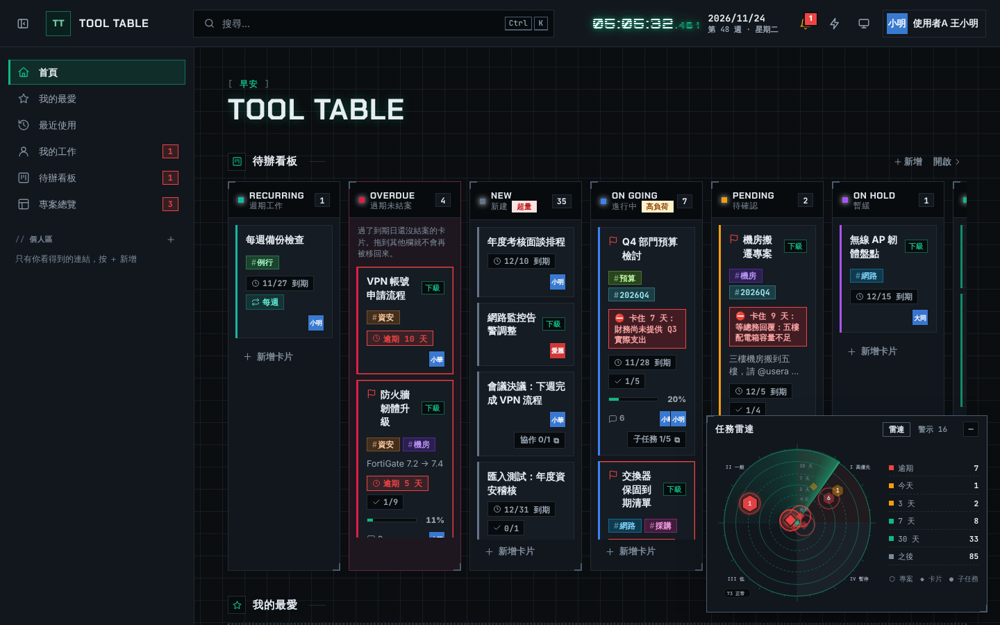
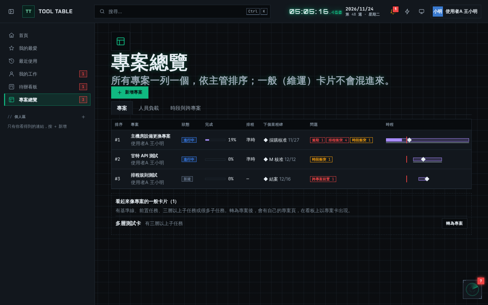
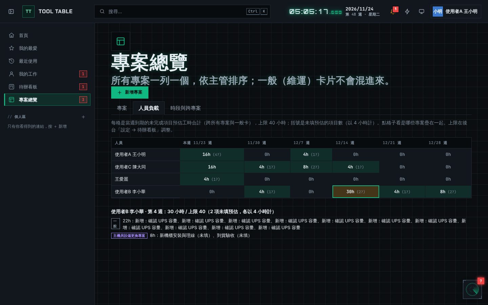
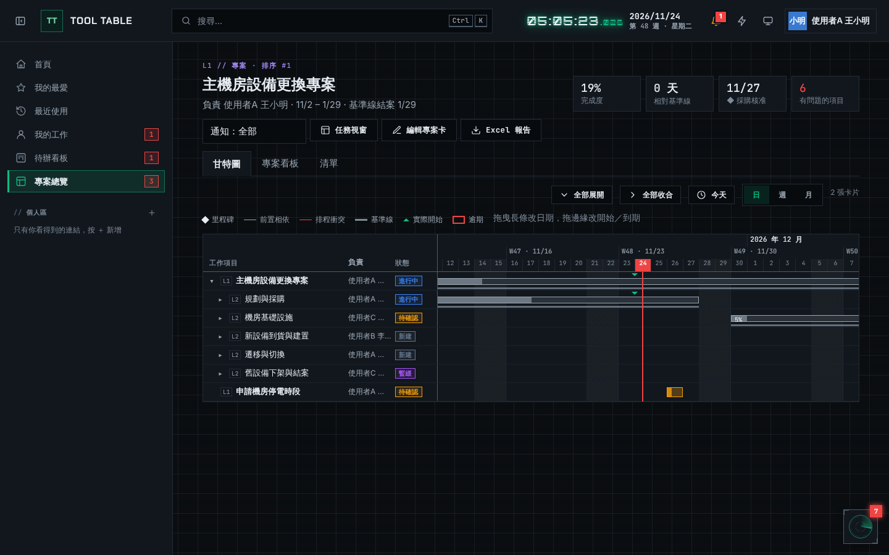
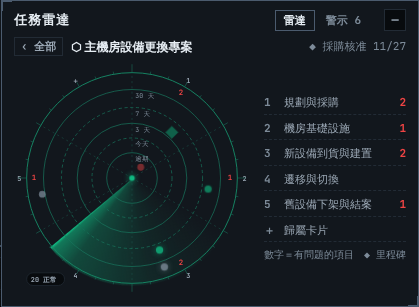

IPMS 的 Windows 用戶端：部門入口網站、待辦看板與多專案管理。可以離線使用，連線後與伺服器雙向同步，單機版與伺服器版功能相同。

## 功能

- **多專案並行**：卡片分「一般（維運）」與「專案」。看板上方的專案摘要列一直都在，切換類型也不會漏看落後的專案。
- **甘特圖**：里程碑、前置任務、基準線、實際開始；拖曳長條改日期，有後續工作時會詢問是否一起順延。可以跟看板連動，也可以獨立使用。
- **專案總覽**：依主管排序列出所有專案的完成度、落後天數、下個里程碑與問題數。
- **人員負載**：人 × 週的預估工時熱圖，跨所有專案與一般卡，超過每週上限就標紅。
- **共用時段與跨專案前置**：停電、維護窗口、變更凍結期被太多專案搶用時，或前置任務在別的專案延誤時，會標出來。
- **任務雷達**：只畫需要注意的項目，一個專案是一個六角形，點進去用扇區看各階段；另有警示清單，可篩選類型、只看我的。
- **專案通知**：每個專案可選全部、只跟我有關、每日摘要或關閉；每天通知落後、跨專案延誤、時段衝突與 3 天內到期的里程碑。
- **我的工作**：所有專案與一般卡裡指派給我的項目，依到期分組。
- **Excel 工作進度報告**：含專案總覽、人員負載、問題清單分頁；改完可以匯入。

| 專案總覽 | 人員負載 |
|---|---|
|  |  |
| **專案頁（甘特圖）** | **專案雷達** |
|  |  |

介紹網站：<https://nox913106.github.io/net-tool-table/>　完整說明見 [README](https://github.com/nox913106/net-tool-table#readme)。

## 安裝

**安裝版（建議）**：下載 `IPMS-Setup.exe` 執行。不需要系統管理員權限，會建立開始功能表與桌面捷徑。升級時直接執行新版；升級或解除安裝都會保留資料。

**免安裝版**：
1. 下載 `IPMS-windows-x64.zip`，解壓縮到任何地方
2. 點兩下 `IPMS.cmd`，瀏覽器會自動開啟
3. 管理後台：入口右上角「後台」

不需要安裝 Python。程式以 python.org 官方簽章的 `python.exe` 執行，套件裡沒有任何自製的執行檔，因此不會被公司防毒誤判刪除。

**連上伺服器**：按頁首的同步標記（「單機」），輸入伺服器網址與 AD 帳號密碼。離線時照常使用，連線後自動同步；伺服器的通知也會送到單機版。

新版會自動更新到這裡。
